# SubastApp

Plataforma de subastas en línea. Quien vende publica un lote con fotos, precio de salida y fecha de cierre. Quien compra oferta hasta el último segundo y, si gana, paga desde su panel.

Está hecha con React, Express y MongoDB. El pago es una simulación: no hay pasarela conectada ni se cobra dinero.

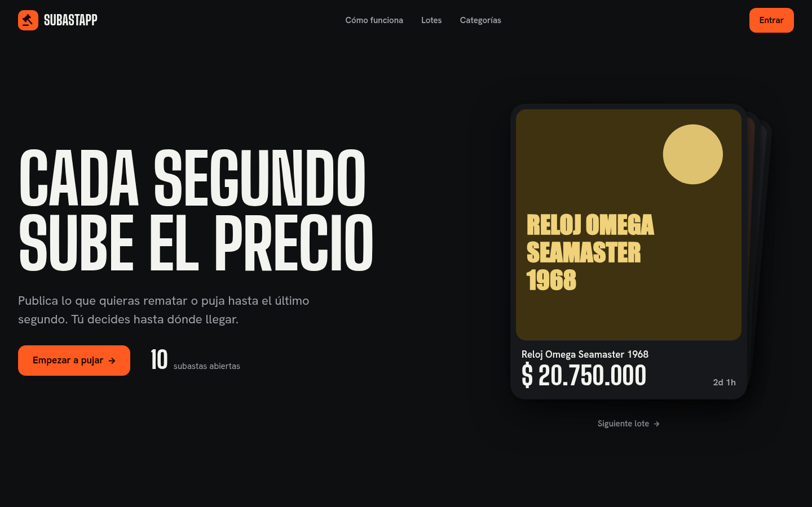

## Cómo correrlo en tu computadora

Necesitas [Node.js](https://nodejs.org) 18 o superior y MongoDB. Si no tienes MongoDB instalado y sí Docker, esto lo levanta en un minuto:

```bash
docker run -d --name subastapp-mongo -p 27017:27017 mongo:7
```

Con Mongo en marcha:

```bash
git clone https://github.com/fabiiianac15/SubastaApp.git
cd SubastaApp
npm run setup   # instala dependencias y crea los .env con un JWT_SECRET propio
npm run seed    # carga 11 lotes y 2 cuentas de prueba
npm run dev     # arranca la API y la app web juntas
```

Abre <http://localhost:3000> y entra con una de estas cuentas:

| Rol | Correo | Contraseña |
| --- | --- | --- |
| Comprador | `comprador@demo.subastapp.co` | `Demo1234` |
| Vendedor | `vendedor@demo.subastapp.co` | `Demo1234` |

La API queda en <http://localhost:5000/api>. Puedes comprobarla con <http://localhost:5000/api/health>.

El seed se puede repetir para reiniciar la demostración. Solo borra y recrea las cuentas `@demo.subastapp.co` y lo que les pertenece, y se niega a correr con `NODE_ENV=production`.

### Problemas comunes

| Síntoma | Causa y solución |
| --- | --- |
| `Error conectando a MongoDB` | Mongo no está corriendo o `MONGODB_URI` en `backend/.env` apunta a otro lado. |
| `Faltan JWT_SECRET o MONGODB_URI` | Falta `backend/.env`. Ejecuta `node scripts/setup.js`. |
| El puerto 3000 o 5000 está ocupado | Cambia `PORT` en `backend/.env`. Si cambias el de la API, ajusta también `REACT_APP_API_URL` en `frontend/.env` y `CORS_ORIGIN` si la web corre en otro puerto. |
| El navegador pide tu ubicación | Es parte de la analítica de sesión. Puedes rechazarla: la app funciona igual. |

### Pruebas

```bash
npm test                      # API: 13 pruebas de integración
npm test --prefix frontend    # web: prueba de la portada
```

Las pruebas de la API necesitan Mongo y usan la base `subastapp_test`, que **se borra al empezar**. Para usar otra instancia: `TEST_MONGODB_URI=mongodb://host:puerto/mi_base_test npm test`. El nombre debe contener `test`.

## Qué hace

| Cuenta | Puede |
| --- | --- |
| Sin sesión | Ver la portada y los lotes públicos abiertos. |
| Comprador | Explorar, guardar favoritos, ofertar, retirar ofertas superadas y pagar lo que gana. |
| Vendedor | Publicar, editar, pausar, finalizar y eliminar sus subastas, y ver sus cifras. |

| Inicio | Explorar |
| --- | --- |
| 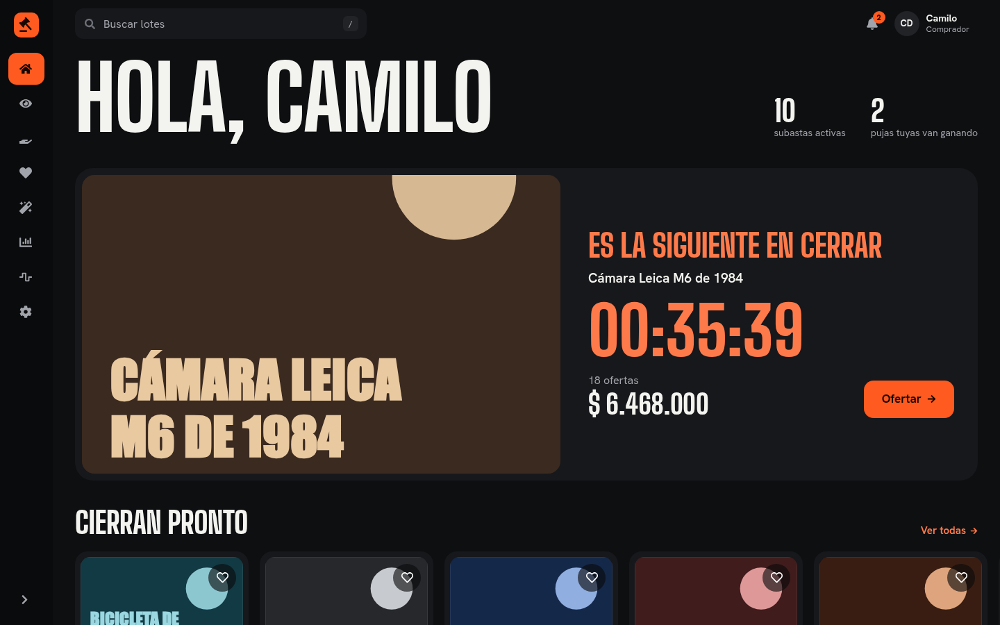 | 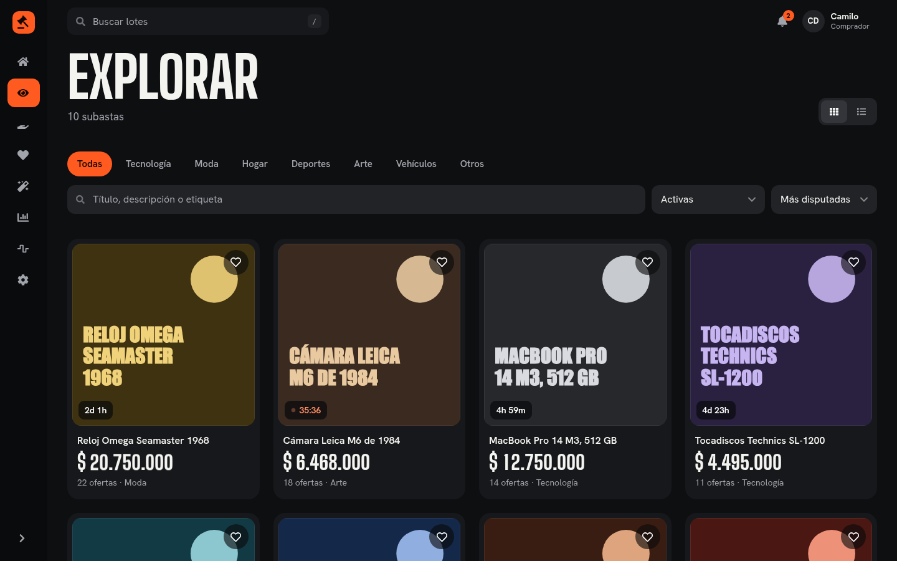 |

| Ficha y oferta | Mis pujas |
| --- | --- |
| 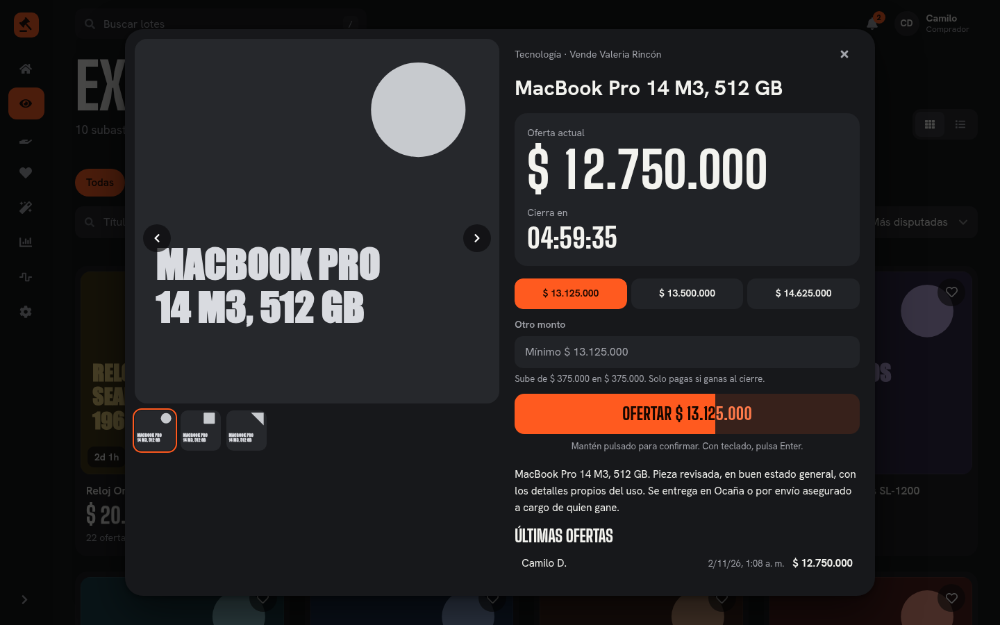 | 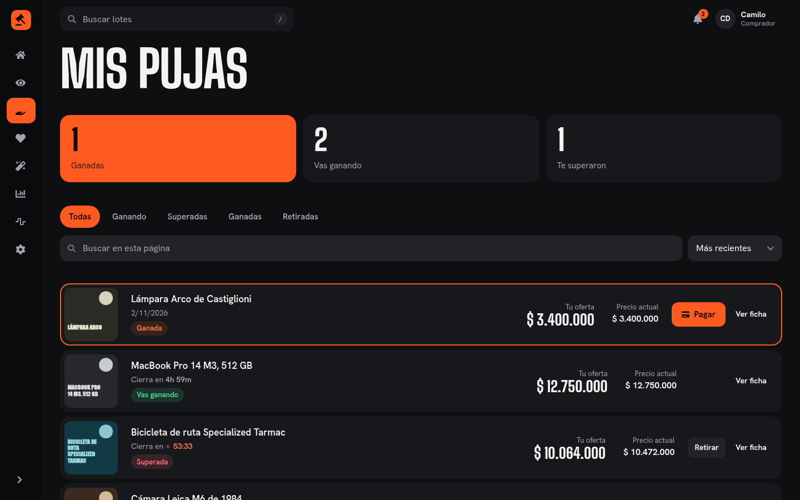 |

| Mis subastas | Crear subasta |
| --- | --- |
| 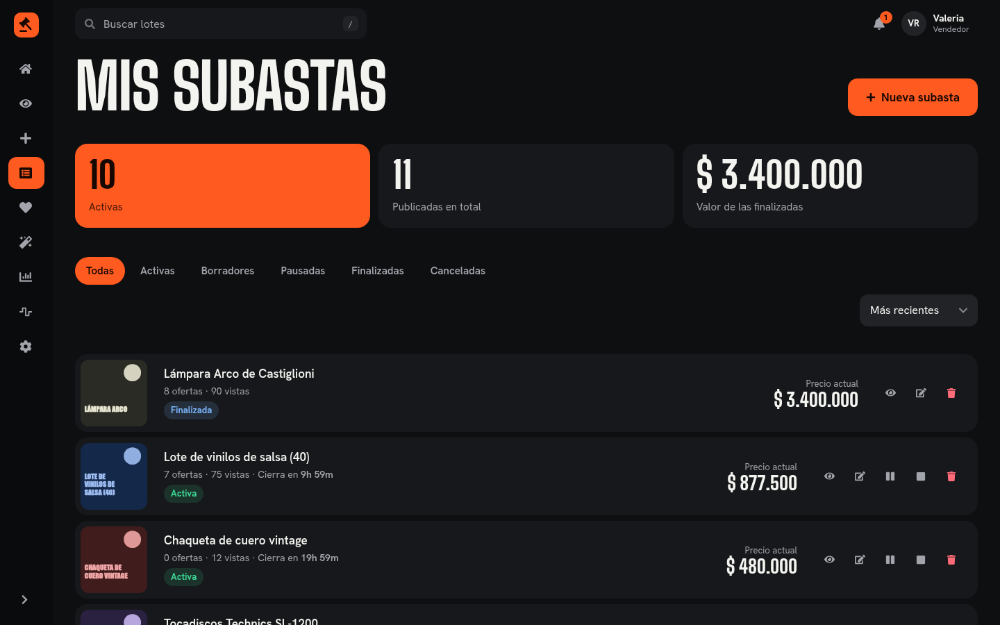 | 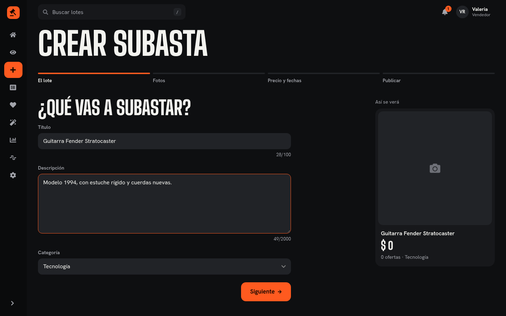 |

| Tema claro | Móvil |
| --- | --- |
| 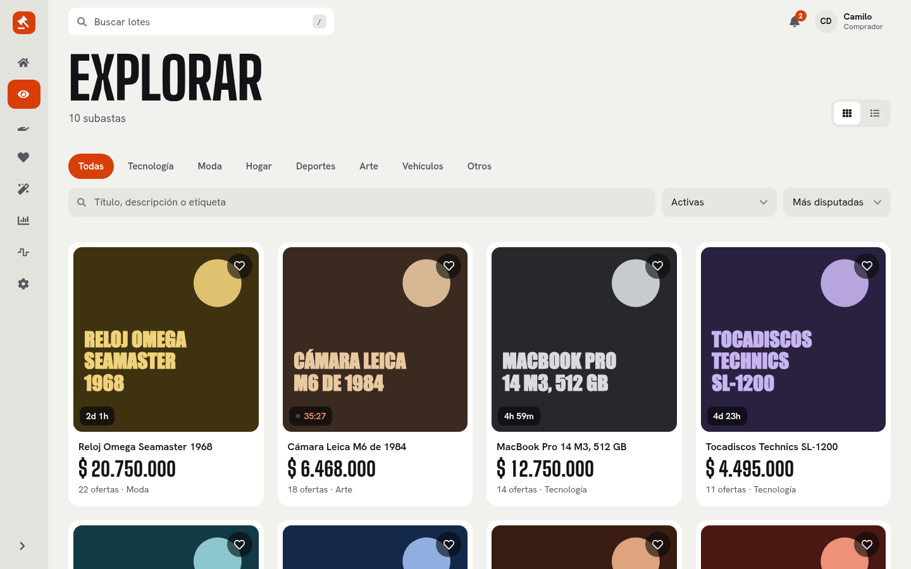 | 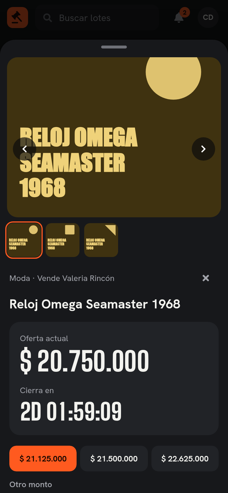 |

## Arquitectura

El navegador habla por HTTP con una API REST. La API guarda los datos en MongoDB y las fotos en disco. Un proceso periódico dentro de la misma API abre y cierra subastas según sus fechas.

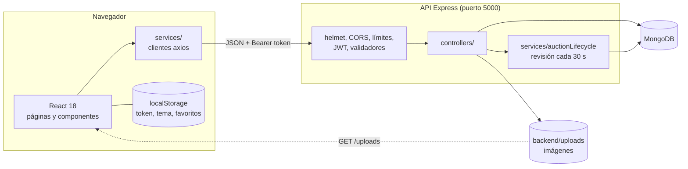

### Estructura del repositorio

```text
SubastaApp/
├── package.json             scripts raíz: setup, seed, dev, test
├── scripts/setup.js         crea los .env locales
├── docs/                    API.md e imágenes
├── backend/
│   ├── app.js               middlewares y rutas
│   ├── server.js            conexión a Mongo, arranque y revisión periódica
│   ├── routes/              endpoints y permisos por ruta
│   ├── controllers/         lógica de cada recurso
│   ├── models/              esquemas: User, Product, Bid, Notification, UserActivity
│   ├── services/            ciclo de vida de subastas y archivos de imagen
│   ├── middleware/          autenticación, validadores, validación de ids
│   ├── scripts/seed.js      datos de demostración
│   └── tests/               pruebas de integración
└── frontend/src/
    ├── App.js               rutas
    ├── pages/               una carpeta por área
    ├── components/ui/       odómetro, botón de mantener, diálogo, ficha de lote
    ├── components/layout/   marco del panel, persistente entre rutas
    ├── services/            llamadas a la API
    ├── context/             sesión
    ├── styles/system.css    tokens de color, tipografía y controles
    └── lib/motion.js        duraciones y curvas de animación
```

La API está documentada endpoint por endpoint en [docs/API.md](docs/API.md).

### Modelo de datos

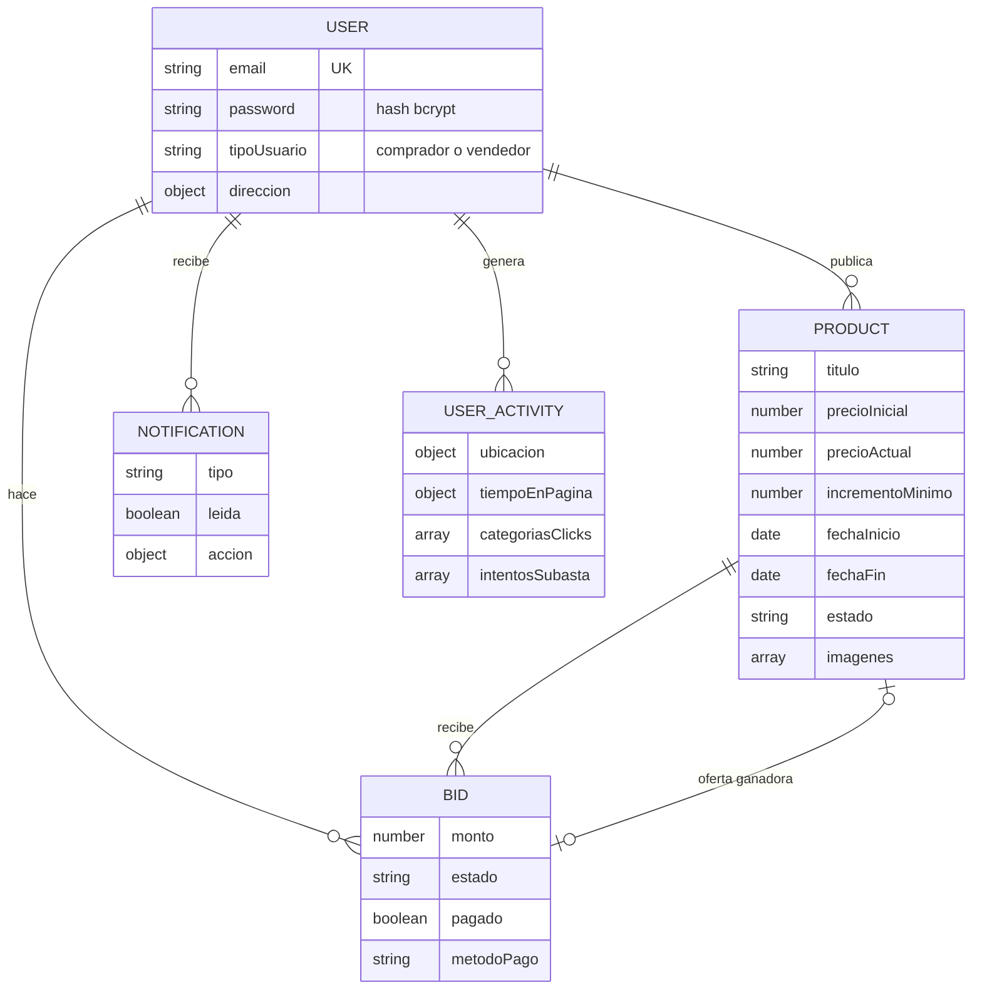

## Flujos

### De la publicación al pago

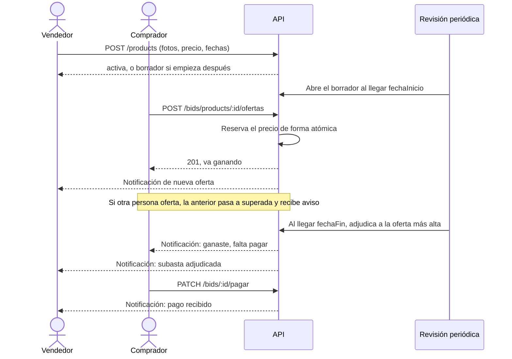

### Estados de una subasta

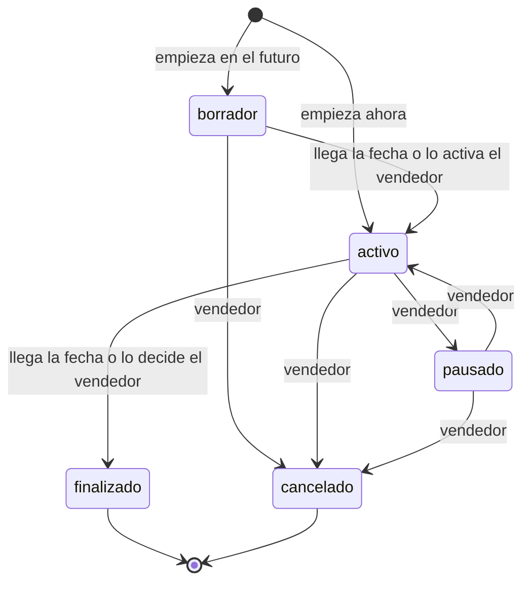

### Estados de una oferta

Una oferta nace `activa` y solo hay una activa por subasta: la más alta. Al ser superada pasa a `superada`, y durante 30 minutos su dueño puede dejarla como `retirada`. Al cierre, la activa pasa a `ganadora` y queda lista para pagarse.

## Reglas que conviene conocer

- Cada oferta debe superar el precio actual por lo menos en el incremento mínimo, calculado como un porcentaje del precio de salida.
- Si dos personas ofertan al mismo tiempo, gana la primera en llegar. La otra recibe un error 409 y vuelve a ver el precio.
- Una subasta con ofertas solo deja editar título, descripción, condiciones y etiquetas.
- Las subastas privadas solo las ven su vendedor y los usuarios invitados en `usuariosInvitados`. La interfaz todavía no permite elegir invitados.
- La ventana de 30 minutos para retirar una oferta se cuenta desde que se hizo.

## Diseño de la interfaz

El sistema está en `frontend/src/styles/system.css`: un fondo, una tinta y un acento bermellón, en tema oscuro y claro. Usa Big Shoulders Display para títulos y precios, y Hanken Grotesk para el resto, ambas autoalojadas.

Las animaciones usan Framer Motion y respetan la preferencia de movimiento reducido del sistema. Las interacciones más propias de la app son mantener pulsado para ofertar (con Enter desde teclado), el golpe del mazo con el precio rodando dígito a dígito, la ficha que se abre desde su tarjeta y la escena del mazo ligada al scroll en la portada.

Las pantallas capturadas están en [este archivo de Figma](https://www.figma.com/design/ugju8jTqauZ9xVOgVqSSc9). Son capturas de la app como capas, sin biblioteca de componentes.

## Limitaciones conocidas

- **El pago es simulado.** La pantalla lo avisa. Falla al azar el 10 % de las veces para mostrar el estado de error, y no debe usarse con datos reales.
- Los favoritos, la foto de perfil, el tema y las preferencias viven en el `localStorage` de cada navegador, no en la cuenta.
- Los interruptores de notificaciones y privacidad en Ajustes se guardan, pero el servidor todavía no los tiene en cuenta.
- El cambio de moneda a USD cambia el símbolo sin convertir el valor.
- «Para ti» muestra las subastas más recientes: no hay recomendador.
- Las notificaciones y los precios se actualizan al consultar, sin tiempo real. El contador de avisos se refresca cada 30 segundos.
- La sesión guarda el token en `localStorage`, expuesto si la página sufriera un XSS. Para producción conviene una cookie `httpOnly`.
- Las imágenes se guardan en el disco del servidor. Con más de una instancia haría falta almacenamiento compartido.
- La analítica registra ubicación y tiempo de uso de cada sesión. Una publicación real necesitaría una política de datos y el consentimiento correspondiente.
